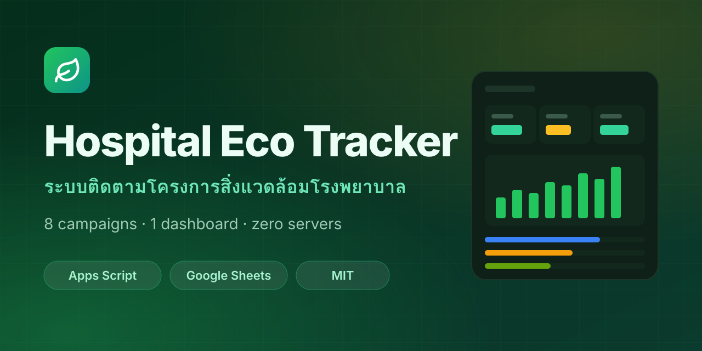

<div align="center">



# 🌱 Hospital Eco Tracker
### ระบบติดตามโครงการสิ่งแวดล้อมโรงพยาบาล

**8 แคมเปญ · 1 แดชบอร์ด · ไม่ต้องมีเซิร์ฟเวอร์**
*8 campaigns · 1 dashboard · zero servers*

[](https://github.com/green-somdej/project-room/actions/workflows/ci.yml)
[](https://green-somdej.github.io/project-room/)
[](LICENSE)


[**🌐 เว็บไซต์โครงการ**](https://green-somdej.github.io/project-room/) · [เริ่มใช้งาน](#-เริ่มใช้งานใน-10-นาที) · [สถาปัตยกรรม](docs/ARCHITECTURE.md) · [แจ้งปัญหา](../../issues/new/choose)

</div>

---

## ✨ ภาพรวม · Overview

แดชบอร์ดเดียวสำหรับติดตามโครงการสิ่งแวดล้อมของโรงพยาบาล ตั้งแต่ความคืบหน้าโครงการรายเดือน ไปจนถึงการแปลงตัวเลขกิจกรรมเป็น **ต้นไม้เทียบเท่า** และ **CO₂ ที่ลดได้** — ทำงานบน Google Apps Script + Google Sheets จึงไม่มีค่าเซิร์ฟเวอร์ และทีมงานเปิดดูข้อมูลดิบได้ตรงๆ ในสเปรดชีต

*A single dashboard for a hospital's environmental programmes: monthly project tracking plus impact reporting (trees & CO₂). Built on Google Apps Script + Google Sheets — no servers to run.*

## 🧭 8 แคมเปญในระบบ

| | โครงการ | สิ่งที่ติดตาม |
|---|---|---|
| 🛢️ | **ทอดไม่ทิ้ง** | น้ำมันใช้แล้วจากบุคลากร แต้มสะสม ระดับสมาชิก อันดับ |
| 📄 | **Paperless** | เรื่องที่เปลี่ยนเป็นอิเล็กทรอนิกส์ + แผ่นกระดาษที่ลดได้ รายหน่วยงาน/เดือน |
| 🖨️ | **ตลับหมึกเก่าเราขอ** | ตลับที่ส่งเข้าโครงการ รอบจำหน่าย รายได้ มูลค่าที่ประหยัด |
| 🍳 | **จากครัวสู่ท้องฟ้า** | น้ำมันทอดจากฝ่ายโภชนาการ รอบส่ง ปริมาณ ราคา |
| 📅 | **ปฏิทินเก่าเราขอ** | น้ำหนักปฏิทินบริจาคเพื่อทำอักษรเบรลล์ ต่อรอบ/ผู้บริจาค |
| ♻️ | **คัดแยก แบ่งปัน** | วัสดุสำนักงานส่วนเกิน ตรวจรับ สต็อก การเบิก |
| 🧪 | **น้ำยา EM** | รอบหมักเศษอาหาร 7/15/45 วัน สต็อกและการนำไปใช้ |
| 🪴 | **ปุ๋ยหมักใบไม้** | กองหมัก บันทึกประจำวัน การนำไปใช้ |

พร้อมภาพรวมโครงการ (Gantt, KPI, สัดส่วน), คลังโครงการ, รายงานสิ่งแวดล้อมรวม, ผู้ช่วยตอบคำถาม, ฟอร์มสาธารณะ + QR Code, ส่งออก Excel และ REST API

## 🏗️ สถาปัตยกรรม

```
Browser (Index/CSS/JS) ──google.script.run──▶ Apps Script Web App (Code.gs) ──▶ Google Sheets (38 ตาราง)
                                                   │                          ├─▶ Drive (รูปภาพ)
                                                   └── doGet/doPost REST API  └─▶ Gmail (ส่งต่อคำถาม)
```

รายละเอียดเพิ่มเติม: [docs/ARCHITECTURE.md](docs/ARCHITECTURE.md)

## 📁 โครงสร้างรีโป

```
src/
  Code.gs          Backend ทั้งหมด (โมดูลละโครงการ + auth + API)
  Portal.gs        บัญชีผู้ใช้หน้าเว็บ + อนุมัติโดยผู้ดูแล + ปกปิดข้อมูล/PDPA
  Hub.gs           ศูนย์ร่วมโครงการ: ใครร่วมโครงการไหนได้ / สมัครหลายโครงการ / หน่วยงาน / ประชาชน-บริษัท
  ExecSlides.gs    สรุปผู้บริหาร Google Slides 16:9 รายโครงการ (อัปเดตอัตโนมัติ)
  Index.html       โครงหน้าเว็บ + แท็บทุกโครงการ
  CSS.html         สไตล์ + ธีมสีรายโครงการ
  JS.html          ตรรกะฝั่งเบราว์เซอร์
  appsscript.json  Manifest (Asia/Bangkok, V8, Web App)
docs/              เว็บไซต์ GitHub Pages
scripts/check.mjs  ตรวจ syntax ก่อน push
.github/           CI, Pages deploy, issue/PR templates
```

## 🚀 เริ่มใช้งานใน 10 นาที

**วิธี A — คัดลอกวาง (ง่ายสุด)**
1. สร้าง Google Sheet ใหม่ → `Extensions → Apps Script`
2. สร้างไฟล์ให้ตรงชื่อ: `Code.gs`, `Index` (HTML), `CSS` (HTML), `JS` (HTML) แล้ววางเนื้อหาจาก `src/`
3. รันฟังก์ชัน `setupSheets()` หนึ่งครั้ง (อนุญาตสิทธิ์)
4. **เปลี่ยน PIN เริ่มต้น** ตาม [SECURITY.md](SECURITY.md)
5. `Deploy → New deployment → Web app` · Execute as **Me** · Access **Anyone**

**วิธี B — clasp (แนะนำสำหรับนักพัฒนา)**
```bash
git clone https://github.com/green-somdej/project-room.git
cd project-room && npm install
npx clasp login
npx clasp create --type webapp --title "Hospital Eco Tracker" --rootDir src
npm run push && npm run deploy
```

### เปิดระบบผ่านหน้า GitHub Pages
หน้า `https://green-somdej.github.io/project-room/` แสดงระบบจริงให้ใช้งานได้ทันที เมื่อใส่ลิงก์ Web App (`…/exec`) ใน [`docs/config.js`](docs/config.js) ที่ `APP_URL` · ลิงก์ตรงเข้าโครงการใช้ได้ เช่น `…/project-room/?page=paperless`

> ⚠️ `clasp create` จะสร้าง `.clasp.json` ซึ่งถูก `.gitignore` ไว้แล้ว — ห้าม commit Script ID ของระบบจริง

## 🤝 ศูนย์ร่วมโครงการ (v1.9.0)

หน้า **`join.html`** (ปุ่ม "🤝 ร่วมโครงการ" ที่หน้าหลัก) — **เลือกว่าคุณคือใคร → ติ๊กหลายโครงการ → สมัครครั้งเดียว**

| กลุ่ม | วิธีร่วม |
|---|---|
| 🩺 เจ้าหน้าที่ | เข้าสู่ระบบครั้งแรก แล้วสมัครหลายโครงการพร้อมกัน (โครงการที่ตั้ง "อนุมัติอัตโนมัติ" เป็นสมาชิกทันที) |
| 🏢 หน่วยงาน | เจ้าหน้าที่ยื่นคำขอแทนหน่วยงาน หลายโครงการพร้อมกัน → ผู้ดูแลอนุมัติ → ระบบเพิ่มหน่วยงานในโครงการให้ |
| 🙋 ประชาชน / 🏭 บริษัท | ลงทะเบียนครั้งเดียว ไม่ต้องตั้งรหัสผ่าน → ได้รหัสสมาชิกใช้คู่กับเบอร์โทร |

- **ผู้ดูแลกำหนดว่าโครงการไหนเปิดให้ใคร** — ปุ่ม 🛠️ ผู้ดูแล → ตั้งค่าโครงการ (หรือชีต `HubProjects`) และอนุมัติคำขอทุกประเภทในกล่องเดียว
- **ตัวเลขทุกโครงการดูได้ทั้ง ปี พ.ศ. และ ปีงบประมาณ** (1 ต.ค. – 30 ก.ย.) ทั้งหน้า "ร่วมโครงการ" และการ์ดสรุปในระบบหลัก
- ติดตั้ง: เพิ่ม `src/Hub.gs` + อัปเดต `Code.gs`, `JS.html` → Deploy เวอร์ชันใหม่ · ทดลองก่อนได้ที่ `join.html?demo=1` · รายละเอียด [docs/HUB.md](docs/HUB.md)

## 📽️ สไลด์ผู้บริหาร (ในระบบ)

แท็บ **สไลด์ผู้บริหาร** (เมนูซ้าย หมวด "สรุปผล" หรือลิงก์ `…/exec?page=execdeck`) แสดงสไลด์ 16:9 **รวมทุกโครงการ 1 ชุด ไม่เกิน 10 หน้า** อ้างอิงรายงานสิ่งแวดล้อมและผลการดำเนินงานของทุกแคมเปญ สร้างสดจากข้อมูลล่าสุดทุกครั้งที่เปิด — ไม่ต้องตั้งค่าเพิ่ม

- เลือกปี · ◀ ▶ หรือปุ่มลูกศรบนคีย์บอร์ด · **⛶ นำเสนอ** เต็มจอ · **🖨️ PDF / พิมพ์** (เลือก "บันทึกเป็น PDF" ได้ไฟล์ 16:9)
- หน้าที่ไม่มีข้อมูล (เช่น ยังไม่ตั้งเป้าหมาย) จะถูกข้ามอัตโนมัติ

## 📊 สรุปรายโครงการ (Google Slides 16:9 — ไม่บังคับ)

ระบบสร้างสไลด์สรุปสำหรับผู้บริหาร **1 ไฟล์ต่อโครงการ ไม่เกิน 10 หน้า** จากข้อมูลจริงในชีต และ **อัปเดตอัตโนมัติทุกชั่วโมงเมื่อข้อมูลของโครงการนั้นเปลี่ยน** (ไฟล์/ลิงก์เดิม ไม่ต้องแชร์ใหม่)

1. (ติดตั้งแบบคัดลอกวาง) เพิ่มไฟล์ `ExecSlides.gs` และเปิด `Services (+) → Google Slides API` — แบบ clasp ตั้งไว้ใน `appsscript.json` แล้ว
2. รันฟังก์ชัน `setupExecutiveSummaries()` หนึ่งครั้ง (อนุญาตสิทธิ์ Slides/Drive/Triggers)
3. ลิงก์ของทุกโครงการอยู่ในชีต `ExecutiveDecks` · ไฟล์อยู่ในโฟลเดอร์ Drive "สรุปผู้บริหาร-ระบบติดตามโครงการสิ่งแวดล้อม" (แชร์โฟลเดอร์ให้ผู้บริหารครั้งเดียว)

เมนู **📊 สรุปผู้บริหาร** ในสเปรดชีต: อัปเดตตอนนี้ / สร้างใหม่ทั้งหมด / เปิด-ปิดการอัปเดตอัตโนมัติ / เปิดโฟลเดอร์

## 🔐 ความปลอดภัยและ PDPA

PIN เก็บเป็น SHA-256 · สิทธิ์ผู้ดูแลกำหนดในชีต `Departments` · API Key เก็บใน Script Properties · **PIN ตัวอย่าง `123456` ใช้ทดลองเท่านั้น** อ่านเพิ่มที่ [SECURITY.md](SECURITY.md)

**หน้าเว็บ GitHub Pages (v1.8.0)** — **ทุกคนดูโครงการ สรุป และสถานะภาพรวมได้โดยไม่ต้องเข้าสู่ระบบ** ส่วนการสมัครเข้าร่วมโครงการต้องเป็นสมาชิก (รหัสเจ้าหน้าที่ 7 หลักซ่อนตัวเลขขณะพิมพ์ + รหัสผ่าน)
1. ผู้ใช้ใหม่เลือก **ใช้งานครั้งแรก** → ติ๊กรับทราบประกาศความเป็นส่วนตัว → ใช้งานได้ทันที 2 ชั่วโมง
2. ระบบ **แจ้งผู้ดูแลทางอีเมล** และแสดงตัวเลขบนปุ่ม **🪪 ตรวจสอบบัญชีผู้ใช้** (เข้าสู่ระบบผู้ดูแลในแอป) → ผู้ดูแลเทียบกับทะเบียนเจ้าหน้าที่แล้วอนุมัติ
3. ยังไม่อนุมัติ = **เข้าสู่ระบบครั้งถัดไปไม่ได้** และยังไม่เห็นประวัติการร่วมโครงการ
4. สมาชิกที่ได้รับอนุมัติกด **สมัครเข้าร่วม** ที่การ์ดโครงการ → ผู้ดูแลอนุมัติคำขอในปุ่มเดียวกัน → สถานะเป็น "✓ เป็นสมาชิกโครงการ"
5. **เซิร์ฟเวอร์บังคับสมาชิก**: ฟอร์มบันทึกข้อมูลของแต่ละโครงการ (บริจาคน้ำมัน ส่งตลับหมึก แจ้งของแบ่งปัน ส่งปฏิทิน บันทึก/ใช้ EM และปุ๋ยหมัก) ต้องกรอก "รหัสสมาชิกโครงการ" ที่ได้รับอนุมัติแล้วจึงบันทึกได้ (ผู้บริจาค/ผู้ขอภายนอกไม่ต้อง) — ปิด/เปิดกฎได้ด้วย `disablePortalMembershipRule()` / `enablePortalMembershipRule()` รายละเอียดและข้อจำกัดดู SECURITY.md
4. หน้าเว็บแสดงรหัส/ชื่อแบบปกปิดบางส่วน (`•••••67`, `สมชาย ร•••`) ไม่เก็บค่าเต็มในเครื่อง; ตารางอันดับสาธารณะปกปิดและไม่แสดงเบอร์โทร (ปกปิดที่เซิร์ฟเวอร์)
5. จำกัดสิทธิ์แชร์ Google Sheet ได้โดยหน้าเว็บยังใช้ได้ (Web App รันด้วยสิทธิ์เจ้าของสคริปต์) — แนะนำรัน `setupPortalPrivateSpreadsheet()` แยกชีตบัญชีไปไฟล์ส่วนตัว

ตั้งค่าครั้งเดียว: แก้ `PRIVACY` ใน `docs/config.js` · อัปเดต Apps Script ให้มีไฟล์ **`Portal.gs`** (ไฟล์ใหม่) พร้อม `Code.gs`, `JS.html`, `Index.html`, `CSS.html` แล้ว Deploy เวอร์ชันใหม่ · รัน `createPortalRetentionTrigger()`

## 🤝 ร่วมพัฒนา

ดู [CONTRIBUTING.md](CONTRIBUTING.md) — รันตรวจโค้ดด้วย `npm run check`

## 📄 License

[MIT](LICENSE) © 2026 Green Somdej
