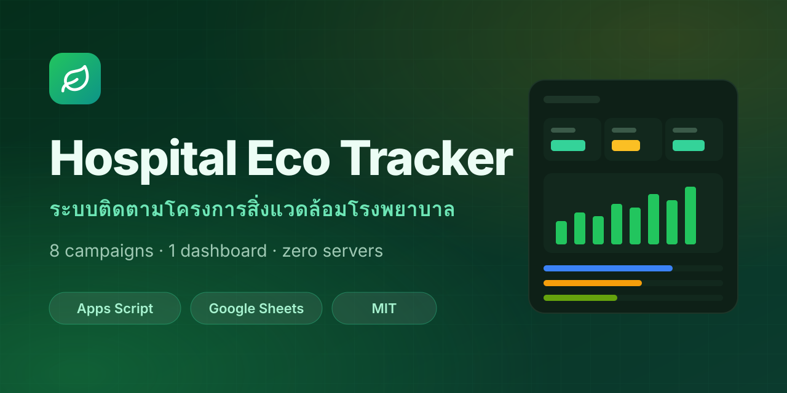

<div align="center">



# 🌱 Hospital Eco Tracker
### ระบบติดตามโครงการสิ่งแวดล้อมโรงพยาบาล

**8 แคมเปญ · 1 แดชบอร์ด · ไม่ต้องมีเซิร์ฟเวอร์**
*8 campaigns · 1 dashboard · zero servers*

[](https://github.com/green-somdej/project-room/actions/workflows/ci.yml)
[](https://green-somdej.github.io/project-room/)
[](LICENSE)


[**🌐 เว็บไซต์โครงการ**](https://green-somdej.github.io/project-room/) · [เริ่มใช้งาน](#-เริ่มใช้งานใน-10-นาที) · [สถาปัตยกรรม](docs/ARCHITECTURE.md) · [แจ้งปัญหา](../../issues/new/choose)

</div>

---

## ✨ ภาพรวม · Overview

แดชบอร์ดเดียวสำหรับติดตามโครงการสิ่งแวดล้อมของโรงพยาบาล ตั้งแต่ความคืบหน้าโครงการรายเดือน ไปจนถึงการแปลงตัวเลขกิจกรรมเป็น **ต้นไม้เทียบเท่า** และ **CO₂ ที่ลดได้** — ทำงานบน Google Apps Script + Google Sheets จึงไม่มีค่าเซิร์ฟเวอร์ และทีมงานเปิดดูข้อมูลดิบได้ตรงๆ ในสเปรดชีต

*A single dashboard for a hospital's environmental programmes: monthly project tracking plus impact reporting (trees & CO₂). Built on Google Apps Script + Google Sheets — no servers to run.*

## 🧭 8 แคมเปญในระบบ

| | โครงการ | สิ่งที่ติดตาม |
|---|---|---|
| 🛢️ | **ทอดไม่ทิ้ง** | น้ำมันใช้แล้วจากบุคลากร แต้มสะสม ระดับสมาชิก อันดับ |
| 📄 | **Paperless** | เรื่องที่เปลี่ยนเป็นอิเล็กทรอนิกส์ + แผ่นกระดาษที่ลดได้ รายหน่วยงาน/เดือน |
| 🖨️ | **ตลับหมึกเก่าเราขอ** | ตลับที่ส่งเข้าโครงการ รอบจำหน่าย รายได้ มูลค่าที่ประหยัด |
| 🍳 | **จากครัวสู่ท้องฟ้า** | น้ำมันทอดจากฝ่ายโภชนาการ รอบส่ง ปริมาณ ราคา |
| 📅 | **ปฏิทินเก่าเราขอ** | น้ำหนักปฏิทินบริจาคเพื่อทำอักษรเบรลล์ ต่อรอบ/ผู้บริจาค |
| ♻️ | **คัดแยก แบ่งปัน** | วัสดุสำนักงานส่วนเกิน ตรวจรับ สต็อก การเบิก |
| 🧪 | **น้ำยา EM** | รอบหมักเศษอาหาร 7/15/45 วัน สต็อกและการนำไปใช้ |
| 🪴 | **ปุ๋ยหมักใบไม้** | กองหมัก บันทึกประจำวัน การนำไปใช้ |

พร้อมภาพรวมโครงการ (Gantt, KPI, สัดส่วน), คลังโครงการ, รายงานสิ่งแวดล้อมรวม, ผู้ช่วยตอบคำถาม, ฟอร์มสาธารณะ + QR Code, ส่งออก Excel และ REST API

## 🏗️ สถาปัตยกรรม

```
Browser (Index/CSS/JS) ──google.script.run──▶ Apps Script Web App (Code.gs) ──▶ Google Sheets (38 ตาราง)
                                                   │                          ├─▶ Drive (รูปภาพ)
                                                   └── doGet/doPost REST API  └─▶ Gmail (ส่งต่อคำถาม)
```

รายละเอียดเพิ่มเติม: [docs/ARCHITECTURE.md](docs/ARCHITECTURE.md)

## 📁 โครงสร้างรีโป

```
src/
  Code.gs          Backend ทั้งหมด (โมดูลละโครงการ + auth + API)
  Index.html       โครงหน้าเว็บ + แท็บทุกโครงการ
  CSS.html         สไตล์ + ธีมสีรายโครงการ
  JS.html          ตรรกะฝั่งเบราว์เซอร์
  appsscript.json  Manifest (Asia/Bangkok, V8, Web App)
docs/              เว็บไซต์ GitHub Pages
scripts/check.mjs  ตรวจ syntax ก่อน push
.github/           CI, Pages deploy, issue/PR templates
```

## 🚀 เริ่มใช้งานใน 10 นาที

**วิธี A — คัดลอกวาง (ง่ายสุด)**
1. สร้าง Google Sheet ใหม่ → `Extensions → Apps Script`
2. สร้างไฟล์ให้ตรงชื่อ: `Code.gs`, `Index` (HTML), `CSS` (HTML), `JS` (HTML) แล้ววางเนื้อหาจาก `src/`
3. รันฟังก์ชัน `setupSheets()` หนึ่งครั้ง (อนุญาตสิทธิ์)
4. **เปลี่ยน PIN เริ่มต้น** ตาม [SECURITY.md](SECURITY.md)
5. `Deploy → New deployment → Web app` · Execute as **Me** · Access **Anyone**

**วิธี B — clasp (แนะนำสำหรับนักพัฒนา)**
```bash
git clone https://github.com/green-somdej/project-room.git
cd project-room && npm install
npx clasp login
npx clasp create --type webapp --title "Hospital Eco Tracker" --rootDir src
npm run push && npm run deploy
```

### เปิดระบบผ่านหน้า GitHub Pages
หน้า `https://green-somdej.github.io/project-room/` แสดงระบบจริงให้ใช้งานได้ทันที เมื่อใส่ลิงก์ Web App (`…/exec`) ใน [`docs/config.js`](docs/config.js) ที่ `APP_URL` · ลิงก์ตรงเข้าโครงการใช้ได้ เช่น `…/project-room/?page=paperless`

> ⚠️ `clasp create` จะสร้าง `.clasp.json` ซึ่งถูก `.gitignore` ไว้แล้ว — ห้าม commit Script ID ของระบบจริง

## 🔐 ความปลอดภัย

PIN เก็บเป็น SHA-256 · สิทธิ์ผู้ดูแลกำหนดในชีต `Departments` · API Key เก็บใน Script Properties · **PIN ตัวอย่าง `123456` ใช้ทดลองเท่านั้น** อ่านเพิ่มที่ [SECURITY.md](SECURITY.md)

## 🤝 ร่วมพัฒนา

ดู [CONTRIBUTING.md](CONTRIBUTING.md) — รันตรวจโค้ดด้วย `npm run check`

## 📄 License

[MIT](LICENSE) © 2026 Green Somdej
